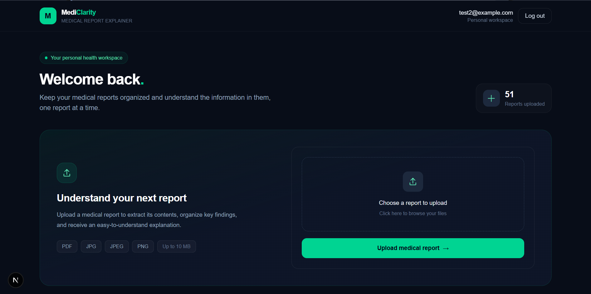
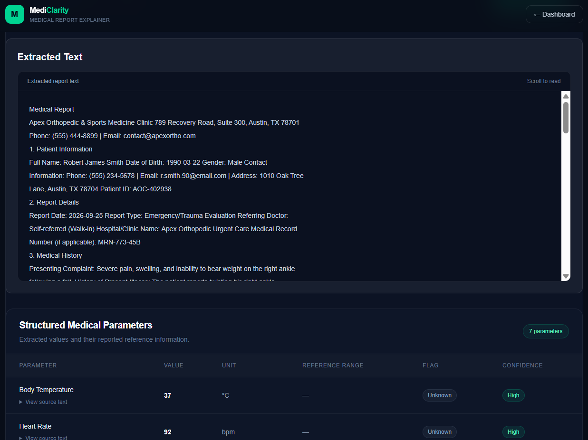
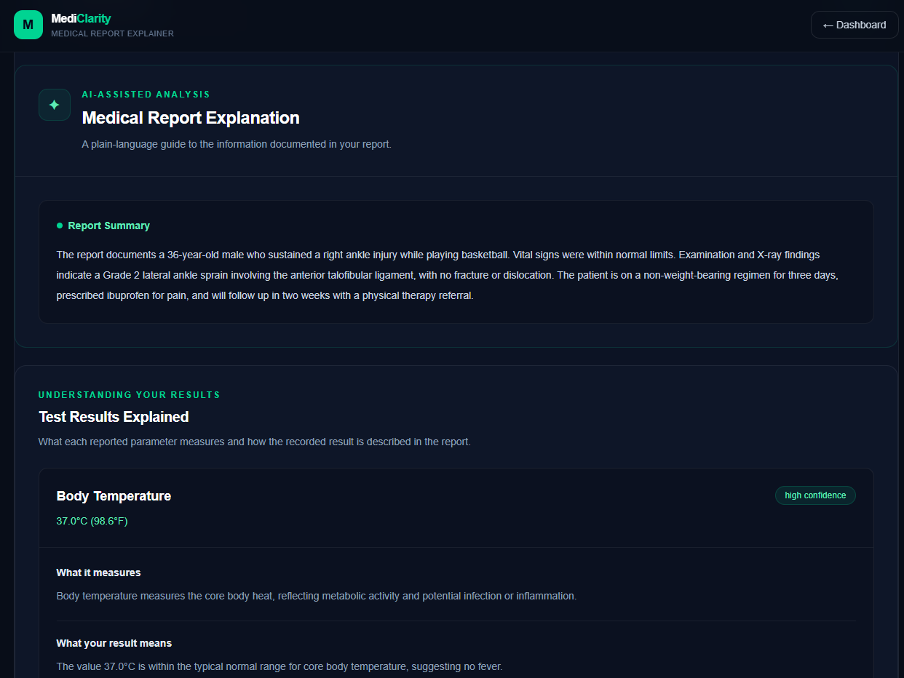
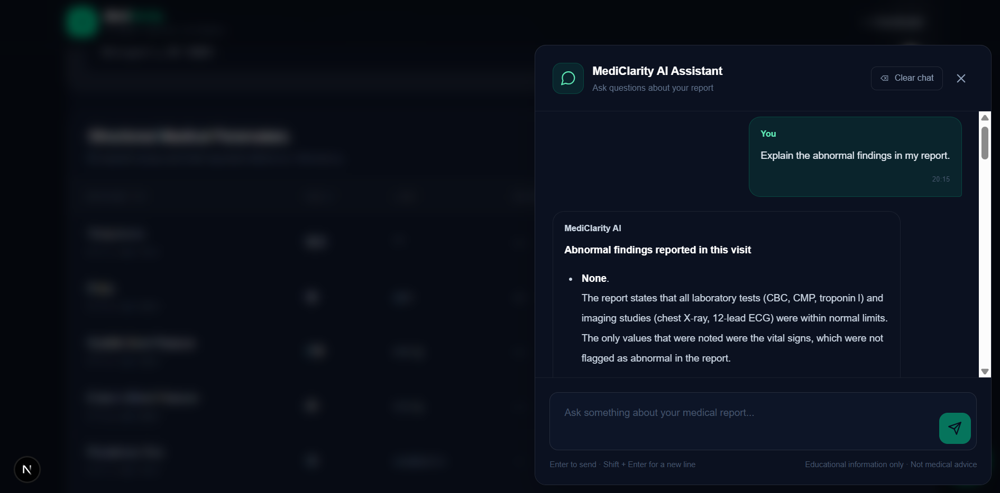
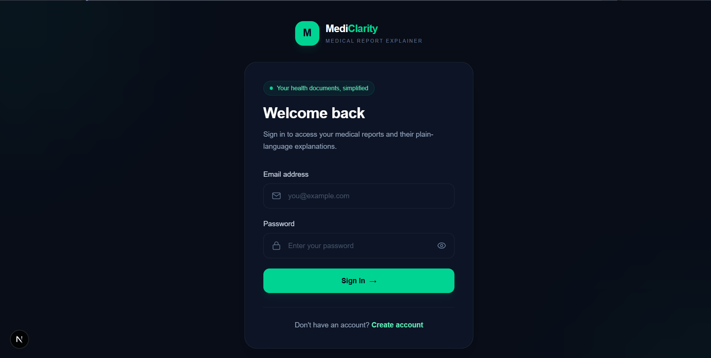
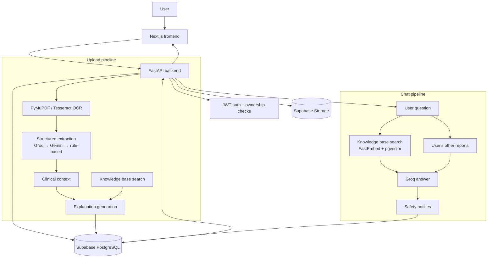

# MediClarity — Medical Report Explainer

**Understand your medical reports in simple, everyday language.**

MediClarity turns lab reports into clear, plain-language explanations. Upload a PDF or image of a report, and MediClarity extracts the text, pulls out each test result, explains what it means, and lets you ask follow-up questions in a chat that is grounded in your own report and a curated medical knowledge base.

It is an **educational tool**, not a diagnostic one: it explains what a report says, cites its sources, and never invents values or reference ranges.

> **Live app:** [medical-report-explainer-lake.vercel.app](https://medical-report-explainer-lake.vercel.app/)
>
> **API docs (Swagger):** [medical-report-explainer-backend.onrender.com/docs](https://medical-report-explainer-backend.onrender.com/docs)

---

## Table of Contents

- [Features](#features)
- [Screenshots](#screenshots)
- [Technology Stack](#technology-stack)
- [System Architecture](#system-architecture)
- [How It Works](#how-it-works)
- [Safety Design](#safety-design)
- [Project Structure](#project-structure)
- [Getting Started](#getting-started)
- [Environment Variables](#environment-variables)
- [Database and Migrations](#database-and-migrations)
- [Utility Scripts](#utility-scripts)
- [Testing and CI](#testing-and-ci)
- [API Endpoints](#api-endpoints)
- [Deployment](#deployment)
- [Known Limitations](#known-limitations)
- [Medical Disclaimer](#medical-disclaimer)
- [Team](#team)

---

## Features

### Report processing
- **Upload** PDF, JPG, JPEG or PNG reports (up to 10 MB), stored privately in Supabase Storage.
- **Text extraction**: PyMuPDF for text-based PDFs, Tesseract OCR for scanned PDFs and images.
- **Structured extraction** of every test into name, value, unit, reference range, flag and source text, with a fallback chain: **Groq → Google Gemini → rule-based parser**.
- **Clinical context** extraction (history, medications, remarks) from the report text.

### Plain-language explanations
- Report summary, what each test measures, what *your* result means, why it matters, important observations and limitations.
- Reference ranges and flags are taken **only from the report**, never invented.
- **Retry button**: if an explanation fails to generate (e.g. an AI provider error), users can generate it again from the report page.

### AI chat assistant
- Ask follow-up questions about a report in a chat window.
- **Retrieval-augmented (RAG)**: each question is matched against a curated medical knowledge base (MedlinePlus-based entries) using vector search; the answer is grounded in the retrieved entries.
- **Source tags** under each answer show which knowledge base entries were used.
- **Cross-report comparison**: ask "How has my hemoglobin changed since my last report?" — the chat compares values across your own reports, labelled by upload date in your local timezone.
- Conversation history is saved per report and can be cleared.

### Accounts and security
- Registration and login with JWT authentication and Argon2 password hashing.
- Every report, file, explanation and chat is scoped to its owner on the backend.

---

## Screenshots

| Dashboard | Report Details |
|---|---|
|  |  |

| Medical Explanation | AI Chat Assistant |
|---|---|
|  |  |

| Login |
|---|
|  |

---

## Technology Stack

### Frontend
| Technology | Purpose |
|---|---|
| Next.js 16 (App Router) + React | User interface |
| TypeScript | Type safety |
| Tailwind CSS v4 | Styling, with shared design tokens in `globals.css` |
| Axios | API requests |
| React Markdown | Rendering chat answers |
| Lucide React | Icons |

### Backend
| Technology | Purpose |
|---|---|
| Python 3.11 + FastAPI | REST API |
| SQLAlchemy + Alembic | ORM and database migrations |
| Pydantic / pydantic-settings | Validation, structured AI output, configuration |
| PyMuPDF, Tesseract OCR, Pillow | Text extraction |
| Groq (`openai/gpt-oss-20b`) | Extraction, explanations and chat |
| Google Gemini | Fallback extraction provider |
| FastEmbed (ONNX) + `all-MiniLM-L6-v2` | Text embeddings for knowledge base search |
| pytest | Automated tests |

### Data and infrastructure
| Technology | Purpose |
|---|---|
| Supabase PostgreSQL + pgvector | Database and vector search |
| Supabase Storage | Private report files |
| Render | Backend hosting |
| Vercel | Frontend hosting |
| GitHub Actions | CI on every pull request |

---

## System Architecture



- **Credentials stay on the server.** The frontend only knows the API URL; database, storage and AI keys live in the backend environment.
- **Knowledge base search** embeds the question with `all-MiniLM-L6-v2` (via FastEmbed / ONNX Runtime) and runs a cosine-similarity search in pgvector. Results below a similarity of 0.5 are discarded.

---

## How It Works

### Uploading a report
1. The file is validated (type, size) and stored in Supabase Storage.
2. Text is extracted with PyMuPDF (PDFs) or Tesseract (images and scanned PDFs).
3. Test results are extracted into structured data (Groq, then Gemini, then a rule-based parser as fallbacks).
4. Clinical context (history, medications, remarks) is extracted.
5. A plain-language explanation is generated, using relevant knowledge base entries as reference, and saved.

### Asking the chat
1. The question is embedded and matched against the knowledge base.
2. The backend gathers context: the current report's text, values, clinical context, a compact version of its explanation, the user's other reports (for comparisons) and recent chat history.
3. Groq generates an answer under strict rules (see below).
4. Fixed safety notices are added if needed, then the answer and its sources are returned and saved.

---

## Safety Design

MediClarity combines **prompt rules** (what the model is told) with **code-level checks** (what is enforced regardless of the model):

| Concern | How it's handled |
|---|---|
| Invented values or ranges | Reference ranges come only from the report; the model must say when the report doesn't provide one |
| Diagnosis | The model explains documented findings; it never diagnoses or predicts outcomes |
| Medication advice | No medicine or class of medicines is named unless the report names it |
| Emergencies | Chat: a fixed emergency notice (call **112** in India) is added in code whenever the question or answer mentions red-flag symptoms. Explanations: critical or urgent findings must include "contact your doctor promptly" |
| Self-harm | A fixed notice with **Tele-MANAS (14416)** is added in code when the user's message suggests self-harm |
| Prompt injection | Retrieved and uploaded text is treated as untrusted data, never as instructions |
| Comparisons | Same test and unit only; direction and flag changes are described without stating causes |
| Error details | Internal errors are logged on the server; users only see short, friendly messages |

---

## Project Structure

```text
medical-report-explainer/
├── .github/workflows/
│   ├── backend-tests.yml      # pytest + migrations on a fresh database
│   └── frontend-checks.yml    # lint + production build
├── backend/
│   ├── app/
│   │   ├── api/               # auth and reports routes
│   │   ├── core/              # config, database, security
│   │   ├── models/            # SQLAlchemy models
│   │   ├── schemas/           # Pydantic schemas (incl. AI output schemas)
│   │   ├── services/          # OCR, extraction, explanation, knowledge base,
│   │   │                      # report history, safety, storage
│   │   └── main.py
│   ├── migrations/            # Alembic migrations
│   ├── scripts/               # embed_kb, search_kb, regenerate_explanation
│   ├── tests/                 # pytest suite
│   ├── .env.example
│   ├── alembic.ini
│   ├── Dockerfile
│   └── requirements.txt
├── frontend/
│   ├── src/
│   │   ├── app/               # pages: login, register, dashboard, report details
│   │   ├── components/reports # explanation section, chat, chat widget
│   │   ├── context/           # auth context
│   │   ├── lib/               # Axios client
│   │   ├── services/          # API calls
│   │   └── types/
│   └── package.json
├── screenshots/
└── README.md
```

---

## Getting Started

### Prerequisites
- **Python 3.11+** and **Node.js 20.9+** (CI uses Node 22)
- **Git**
- **Tesseract OCR**, installed separately (the `pytesseract` package only talks to it):
  - **Windows:** install the [UB Mannheim build](https://github.com/UB-Mannheim/tesseract/wiki), then add `C:\Program Files\Tesseract-OCR` to your PATH and restart your terminal/editor
  - **macOS:** `brew install tesseract`
  - **Linux:** `sudo apt install tesseract-ocr`
  - Check with `tesseract --version`
- A **Supabase** project (PostgreSQL with pgvector, and a Storage bucket), a **Groq** API key and optionally a **Gemini** API key

### 1. Clone
```bash
git clone https://github.com/Sarthak-Pattnaik/medical-report-explainer.git
cd medical-report-explainer
```

### 2. Backend
```bash
cd backend
python -m venv .venv

# Windows
.venv\Scripts\activate
# macOS / Linux
source .venv/bin/activate

pip install -r requirements.txt
```
Copy `.env.example` to `.env` and fill in the values (see [Environment Variables](#environment-variables)), then:
```bash
alembic upgrade head
uvicorn app.main:app --reload
```
- API: `http://localhost:8000`
- Swagger UI: `http://localhost:8000/docs`
- Health checks: `/health` and `/health/database`

The first knowledge base search downloads the embedding model (~90 MB) once.

### 3. Frontend
In a second terminal:
```bash
cd frontend
npm install
```
Create `frontend/.env.local`:
```env
NEXT_PUBLIC_API_URL=http://localhost:8000
```
Then:
```bash
npm run dev
```
Open `http://localhost:3000`.

---

## Environment Variables

The full list with comments is in [`backend/.env.example`](backend/.env.example).

### Backend (`backend/.env`)
| Variable | Required | Description |
|---|---|---|
| `DATABASE_URL` | ✅ | Supabase PostgreSQL connection string |
| `JWT_SECRET_KEY` | ✅ | Secret for signing login tokens (same value wherever the database is shared) |
| `GROQ_API_KEY` | ✅ | Groq API key |
| `GEMINI_API_KEY` | | Gemini key for the fallback extractor |
| `SUPABASE_URL` | ✅ | Supabase project URL |
| `SUPABASE_SERVICE_ROLE_KEY` | ✅ | Service role key (server only — never expose it to the frontend) |
| `SUPABASE_STORAGE_BUCKET` | | Defaults to `medical-reports` |
| `GROQ_MODEL` | | Defaults to `openai/gpt-oss-20b` |
| `CORS_ORIGINS` | | Comma-separated allowed frontend URLs. Defaults to localhost and the production Vercel URL |

### Frontend (`frontend/.env.local`)
| Variable | Description |
|---|---|
| `NEXT_PUBLIC_API_URL` | Backend URL (local: `http://localhost:8000`; production: the Render URL) |

`.env` and `.env.local` are git-ignored. Never commit real keys.

---

## Database and Migrations

The schema is managed with **Alembic**.

```bash
alembic upgrade head   # apply all migrations
alembic current        # show the database's migration version
alembic check          # compare models with the database (changes nothing)
```

**Team rule:** all table, column and key changes go through an Alembic migration in a pull request — never through the Supabase dashboard. Run `alembic check` against Supabase after applying a migration to catch drift.

**Knowledge base:** the `kb_entries` table and the `search_kb()` SQL function were created directly in Supabase and are **not** part of the migrations. Alembic is configured to ignore `kb_entries` so autogenerate never tries to drop it.

---

## Utility Scripts

Run from `backend/` with the virtual environment active:

| Command | What it does |
|---|---|
| `python -m scripts.embed_kb` | Creates embeddings for knowledge base entries that don't have one yet |
| `python -m scripts.search_kb` | Test a knowledge base search from the command line |
| `python -m scripts.regenerate_explanation <report_id>` | Re-runs only the explanation step for a report |

---

## Testing and CI

```bash
cd backend
python -m pytest tests -v
```
29 tests cover the API (auth, upload validation, health checks, CORS, explanation retry), safety notices, prompt compaction, timezone formatting and configuration. External services are replaced with fakes, so tests need no database or API keys.

```bash
cd frontend
npm run lint
npm run build
```

**GitHub Actions** runs on every pull request and push to `main`, and all three checks must pass before merging:

| Check | What it runs |
|---|---|
| `test` | Backend pytest suite (Python 3.11) |
| `migrations` | `alembic upgrade head` + `alembic check` on a fresh PostgreSQL |
| `lint-and-build` | Frontend ESLint + production build (Node 22) |

---

## API Endpoints

Full request/response schemas are in the [Swagger UI](https://medical-report-explainer-backend.onrender.com/docs).

| Method | Endpoint | Description |
|---|---|---|
| `POST` | `/auth/register` | Create an account |
| `POST` | `/auth/login` | Log in and receive a JWT |
| `GET` | `/auth/me` | Current user |
| `POST` | `/reports/upload` | Upload and process a report |
| `GET` | `/reports/` | List the user's reports |
| `GET` | `/reports/{report_id}` | Report details |
| `GET` | `/reports/{report_id}/file` | Download the original file |
| `GET` | `/reports/{report_id}/analysis` | Extracted text, structured data and clinical context |
| `GET` | `/reports/{report_id}/explanation` | Saved explanation |
| `POST` | `/reports/{report_id}/explanation/retry` | Generate a missing explanation |
| `POST` | `/reports/{report_id}/chat` | Ask the chat assistant (returns answer + sources) |
| `GET` | `/reports/{report_id}/chat` | Chat history |
| `DELETE` | `/reports/{report_id}/chat` | Clear chat history |
| `GET` | `/health`, `/health/database` | Health checks (`/health/database` returns 503 if the database is unreachable) |

All `/reports` endpoints require a valid token and only return the caller's own data.

---

## Deployment

| Component | Platform |
|---|---|
| Frontend | Vercel (root directory `frontend`) |
| Backend | Render (using `backend/Dockerfile`) |
| Database + vector search | Supabase PostgreSQL + pgvector |
| File storage | Supabase Storage |

- Set backend environment variables in the Render dashboard and `NEXT_PUBLIC_API_URL` in Vercel.
- To allow a new frontend URL, set `CORS_ORIGINS` on Render (list every allowed origin, comma-separated) and redeploy.
- Embeddings run with ONNX Runtime instead of PyTorch, which keeps memory within Render's free tier (≈245 MB vs ≈576 MB for the embedding step).
- Migrations are not run automatically on deploy; apply them with `alembic upgrade head`.

---

## Known Limitations

- **OCR on photos** of reports (blurry, skewed, low-resolution) can fail; clear PDFs work best.
- **Groq free tier:** 8,000 tokens per minute. Uploading a report and chatting within the same minute can briefly fail — waiting about a minute fixes it.
- **Comparisons are ordered by upload time**, not by the test date printed on the report.
- **Uploads are processed synchronously** (OCR + several AI calls in one request), so large files take a while.
- **Knowledge base content** is not stored in the repository, and topics without an entry are answered from the model's general knowledge (without source tags).
- Chat source tags are not stored with messages, so they don't appear when chat history is reloaded.

---

## Medical Disclaimer

MediClarity is for **educational and informational purposes only**.

- Its explanations are not medical diagnoses and may contain errors or omissions.
- Always check extracted values, units, reference ranges and flags against the original report.
- It does not replace a qualified healthcare professional. Do not make medical, medication or treatment decisions based on it.
- In an emergency in India, call **112**.

---

## Team

| Name | GitHub | Main contributions |
|---|---|---|
| Sarthak Pattnaik | [Sarthak-Pattnaik](https://github.com/Sarthak-Pattnaik) | Core application: authentication, upload, OCR, extraction pipeline, explanations, frontend, deployment |
| Shomeraj Dey | [Shomeraj81](https://github.com/Shomeraj81) | Chat RAG and source tags, cross-report comparison, embedding memory fix, safety notices, tests and CI, logging and error handling, migrations, frontend lint and design consistency, explanation retry |